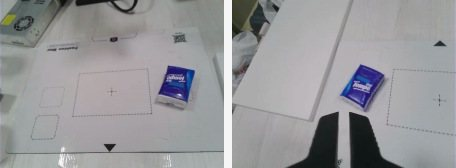

# 基于 RECAP 的 B601-RS 机械臂抓放实验报告

本实验在 B601-RS 机械臂上复现了 π∗₀.₆ 论文中的 RECAP 任务后训练流程。任务是在固定桌面工位抓起蓝色餐巾纸包，搬运到黑框内并松爪。我们先用遥操作示教微调开源 π₀.₅，再从真机自主尝试和人工干预纠正中收集经验，用价值模型生成逐帧优势标签，继续更新策略。最终固定摆位评测中，**42 次有效试验有 30 次全程自主成功，成功率为 71.4%**。

## 1. π₀.₆、π∗₀.₆ 与 RECAP

### 1.1 论文要解决什么问题

Physical Intelligence 的论文《π∗₀.₆：a VLA That Learns From Experience》研究机器人如何在部署后继续学习。人类示教能给机器人一套基本做法，但机器人上机后也会遇到示教里少见的状态，例如物体滑开、夹爪抓偏。论文让初始策略先执行任务，保留自主尝试的成功和失败，以及专家在必要时给出的纠正动作，再利用这些经验更新策略。作者在叠衣、组装纸盒和制作浓缩咖啡等任务上验证了这一流程。[原论文](https://arxiv.org/html/2511.14759v2)

论文中的 **π₀.₆** 是在 π₀.₅ 基础上演进的视觉语言动作模型（VLA）。它把多路相机图像、机器人状态和任务指令作为输入，用 Gemma 3 4B 作为视觉语言主干，并用约 8.6 亿参数的动作专家通过流匹配生成一段连续动作。相较 π₀.₅，π₀.₆ 还扩充了多机器人平台的数据。**π∗₀.₆** 在 π₀.₆ 上加入优势条件，通过 RECAP 训练得到。训练时另有一个较小的、独立的价值模型估计任务进展。[论文第 V 节](https://arxiv.org/html/2511.14759v2#S5)

### 1.2 RECAP 怎样从真机经验里得到训练信号

RECAP 的全称是 *RL with Experience and Corrections via Advantage-conditioned Policies*。它把终局成败转成奖励，用价值模型估计当前进展，再把优势标签作为策略的输入条件。四个概念的作用如下。

| 概念 | 在 RECAP 中的作用 |
| --- | --- |
| **奖励** $r_t$ | 对单个时间步的反馈。论文给执行中的每步计 $-1$，成功终止记 $0$，失败终止给更大的负奖励。因此成功且更快的轨迹回报更高。 |
| **回报** $G_t$ | 从当前步到轨迹结束累计的奖励。记录了一条轨迹的时长和最终成败后，就能为其中各帧算出训练目标。 |
| **价值** $V(o_t,\ell)$ | 价值模型根据当前观测和任务指令，估计从这个状态继续执行的预期回报。论文把回报离散到 201 个区间，学习区间概率，再取期望得到标量价值。 |
| **优势** $A_t$ | 衡量从当前状态执行一段已记录动作后，取得的进展相对原先预期如何。其估计由这段动作期间的奖励、结束状态的价值和起点价值共同决定。 |

论文在任务后训练中向后看 $N=50$ 步。把这段时间的奖励与末端价值相加，再减去起点价值，就得到优势估计。超过任务阈值的帧标为正优势，其他帧标为负优势。专家纠正动作直接标为正。策略训练使用已采集的数据，保留正、负标签并拟合不同条件下的动作分布。对连续动作，论文通过带条件的流匹配更新策略。部署时给策略正优势条件，从偏向有效推进任务的动作分布中采样。[论文第 IV 节](https://arxiv.org/html/2511.14759v2#S4) · [优势估计细节](https://arxiv.org/html/2511.14759v2#A1.SS6)

### 1.3 把论文的训练流程拆成七步

1. **准备多任务示教。** 汇集多种机器人和任务的示教轨迹，按任务定义成败和时间代价，从每条轨迹构造逐步回报。
2. **预训练价值模型。** 用多任务数据学习从当前图像、机器人状态与任务指令预测回报分布，得到可迁移的初始价值模型。
3. **预训练优势条件策略。** 用初始价值模型给训练动作估计优势，并把二值优势指示加入 VLA 的输入，得到能使用这一条件的通用策略。
4. **用目标任务示教初始化。** 针对一个具体任务准备示教，适配该任务的价值模型和初始策略。论文的实现对首次策略微调的示教使用正优势条件，相当于监督微调。
5. **部署当前策略并积累经验。** 让策略执行目标任务，记录完整轨迹和成败。需要时由专家纠正，保留一条轨迹中的自主动作段和纠正动作段，把新轨迹加回任务数据集。
6. **根据累积数据更新价值与优势。** 用迄今记录的任务数据再微调价值模型，重新计算动作优势和正负标签，保留专家纠正帧的强制正标签。
7. **更新策略并回到真机。** 用新的优势标签训练目标任务策略，再部署测试。下一轮用更新后的策略继续采集，重复第 5 至 7 步。

论文的 Algorithm 1 把每轮重复的工作归纳为采集经验、训练价值模型和训练策略三项。原实验各轮的任务价值模型和任务策略从各自的通用预训练检查点初始化，并使用截至该轮的累计任务数据。[Algorithm 1 与任务后训练](https://arxiv.org/html/2511.14759v2#S4.SS3)

## 2. 本次复现的任务与范围

我们在固定桌面工位执行单一的 **Pick and Place** 任务。蓝色餐巾纸包从指定起始位置出发，B601-RS 用夹爪把它抓起、搬入指定黑框，松爪后纸巾包留在框内。模型输入包括俯视和腕部图像、六个关节与夹爪的状态，以及任务指令。最终评测在每次试验前复位纸巾和机械臂，独立运行和判定，每次给模型最多 120 秒。

官方 OpenPI 提供了 π₀.₅ 的代码和基础权重。本实验开展时，原论文所用的 π∗₀.₆ 策略权重未随 OpenPI 提供。我们以 π₀.₅ 为策略底座，在 B601-RS 上自行搭建真机经验采集、回报计算、价值模型适配、优势标注和条件微调，复现一轮 RECAP 式的任务后训练。[OpenPI 官方仓库](https://github.com/Physical-Intelligence/openpi)

## 3. 真机数据

| 批次 | 数量 | 采集方式和用途 |
| --- | ---: | --- |
| 遥操作示教 | 60 条 | 操作者操纵主臂带动 B601-RS 从臂完成抓放，记录完整示教轨迹，为初始策略提供任务动作。 |
| 策略部署采集 | 100 条 | 初始策略在真机上执行任务。39 条全程由策略控制，61 条包含人工干预纠正，为第二轮训练提供真实尝试和恢复动作。 |

### 一条 Episode 长什么样

一条 **Episode** 是一次从任务起点开始到结束的完整轨迹。整条轨迹记录任务、终局成败以及是否发生人工干预。轨迹内约每秒记录 25 帧，每帧有同一时刻的俯视和腕视画面、七维实测状态、七维动作目标、时间戳和动作来源。后训练再把价值、优势和正负标签关联到对应帧号。一次抓放可以同时包含正优势、负优势和人工纠正帧。

以下是实际采集的 `new-012`。这条 Episode 记录了 1,884 帧，最后放置成功，中途有人工干预纠正。

第 251 帧对应约 10.04 秒，图左为俯视画面，图右为腕视画面。该帧七轴实测角度为 `[-19.47, 38.21, 38.91, -27.25, -1.63, -11.32, 16.90]`，动作目标为 `[-19.94, 39.22, -43.06, 26.20, 2.35, -12.62, 3.15]`。两组向量均按 J1 至 J7 排列，最后一维对应夹爪。实测电机角和动作目标采用各自的坐标约定。

| 帧号 | 时间 | 动作来源 | 价值 | 优势 | 训练标签 |
| ---: | ---: | --- | ---: | ---: | --- |
| 4 | 0.16 秒 | 策略 | −0.32361 | −0.03759 | Negative |
| 251 | 10.04 秒 | 策略 | −0.37471 | +0.03501 | Positive |
| 1182 | 47.72 秒 | 人工干预纠正 | −0.15506 | −0.01775 | Positive（人工纠正帧） |

## 4. 实验复现过程

### 4.1 遥操作采集与首次 π₀.₅ 微调

先用主臂带动从臂录制 60 条抓放示教，按整条 Episode 划分，**50 条用于训练，10 条用于验证**。从官方 `pi05_base` 权重开始，通过 OpenPI 做 JAX LoRA 微调。训练完成 43,001 次优化器更新，最终检查点编号为 `43000`。末段日志中的训练 Flow Loss 区间均值为 **0.0015**，该检查点在首轮留出集上的验证 Flow Loss 为 **0.00959243**。该检查点用于第二批真机采集。

### 4.2 部署初始策略并记录真实尝试

让首次微调得到的 π₀.₅ 在真机上输出动作并执行抓放。100 条轨迹中，39 条从头到尾由策略自主执行，包含 **26 条自主成功、13 条自主失败**。其余 **61 条包含人工干预纠正**。操作者在抓偏、纸巾移位或策略停滞等情况下修正动作，再把控制权交回策略。整条 Episode 保留纠正前的状态、人工纠正动作、交回后的策略动作和最后结果。

### 4.3 按奖励构造回报并微调价值模型

两批主体数据合计 160 条真机轨迹。价值学习采用 π∗₀.₆ 论文的奖励思路，由剩余时间和终局成败共同定义回报。本实验用实测秒数衡量时间代价。设 $t$ 为当前时刻，$T$ 为结束时刻，$C$ 为失败惩罚的时间尺度，则第 $t$ 帧的归一化回报目标为

$$
G_t = -\frac{(T-t)+ C\,\mathbf{1}[\text{失败}]}{2C}.
$$

成功轨迹接近结束时回报趋近于 0。失败轨迹在剩余时间代价之外再承担失败惩罚，这个惩罚会反映在该轨迹各帧的回报目标中。训练价值模型时，模型用当前双路图像、七轴实测状态和任务指令来预测这个回报。

我们从开源 Evo-RL 的 `pistar06` 实现取得输出回报分布的双视角价值模型，以公开的堆叠任务价值权重为起点，在 B601 任务数据上微调。用单张 RTX 3090 训练 8,000 步，批大小为 4。由于验证集中失败样本较少，选点时对成功和失败两组的平均绝对误差各赋一半权重。该指标从迁移前的 **0.2962** 降至第 4,000 步的 **0.1757**，后续逐帧打标使用第 4,000 步权重。[Evo-RL 价值模型实现](https://github.com/MINT-SJTU/Evo-RL/tree/b1009248c270515946b96ca90ae5a156f103c637/src/lerobot/values/pistar06)

### 4.4 用微调后的价值模型逐帧打标

用选定的价值模型给记录帧计算 $V_t$，再结合接下来约 **2 秒**的时间代价和价值变化计算优势。遇到人工干预开始、交回策略或本条轨迹结束时，相应截短优势计算窗口。人工干预纠正的有效帧强制标为 **Positive**。对可参与排名的示教帧和自主执行帧，只在训练集上按优势确定阈值，取前 **40%** 标为 **Positive**，其余标为 **Negative**。验证和测试沿用训练集阈值。

标签绑定到帧号。每个策略训练样本从某一帧起取连续 25 个动作，使用起始帧的标签作为条件。动作块留在同一个控制阶段内。因此同一条 Episode 内既可以学到需要避免的自主动作，也能学到跟在它后面的人工纠正动作。

### 4.5 再次微调 π₀.₅ 并部署复测

从首次微调后的 `43000` 检查点继续做优势条件 LoRA 微调。训练时把起始帧的标签接到原任务文本后，例如 `Advantage: positive` 或 `Advantage: negative`，随机省略约 30% 样本的条件。模型据此学习在相同任务下如何根据优势条件生成不同的动作。

第二轮更新 **47,000 步**，批大小为 1。按留出验证片段上六关节与夹爪的综合动作误差选择检查点。部署时，推理服务在原任务指令后固定附加 `Advantage: positive`，把实时图像和状态送入更新后的 π₀.₅。策略输出 25 个控制拍的七轴动作，交给机械臂执行并继续读取新观测。价值模型负责离线打标，真机推理由更新后的策略执行。

## 5. 实验结果

### 真机自主抓放

自主成功要求策略全程完成抓取、搬运和入框释放。发生人工干预的试次计入自主失败，即使干预后完成了放置。更新前取初始策略部署采集的前 30 条有效轨迹作为早期参考。更新后共进行 45 次固定摆位试验，其中 42 次有效。

| 阶段 | 有效试次 | 自主成功 | 自主失败 | 失败中有人工干预 | 自主成功率 |
| --- | ---: | ---: | ---: | ---: | ---: |
| 初始 π₀.₅，部署采集的前 30 条 | 30 | 15 | 15 | 13 | 50.0% |
| RECAP 更新后，固定摆位评测 | 42 | **30** | 12 | 7 | **71.4%** |

更新后的 7 条干预试次最终都完成了放置，按自主判据计入上表的失败。两个阶段都采用全程无人工干预的判据，50.0% 和 71.4% 反映对应批次的实测表现。要量化 RECAP 本身带来的增益，还需在同一摆位和干预方案下对照新旧策略。

### 动作预测误差

在同一组 10 条留出轨迹的 30 个正优势动作片段上，比较两版策略的预测动作与实际记录动作。指标为平均绝对误差（MAE）。

| 指标 | 首次微调后的 π₀.₅ | RECAP 更新后 | 相对降幅 |
| --- | ---: | ---: | ---: |
| 六关节平均 MAE | 2.006° | **1.203°** | 40.0% |
| 夹爪 MAE | 2.411° | **0.296°** | 87.7% |

### 真机演示

第 49 条固定摆位试验的 20 秒片段展示了抓起蓝色餐巾纸包、搬运到黑框和松爪的过程。[观看实拍视频](assets/b601-pick-place-demo.mp4)

## 6. 总结

本实验在单臂桌面抓放任务上完成了从初始示教、真机经验与人工纠正，到价值学习、逐帧优势标注和策略再部署的一轮流程。更新后的 π₀.₅ 在留出数据上更接近记录动作，在固定工位上也完成了更多全程自主抓放。实验中，自主失败提供了动作质量和终局回报的信号，人工纠正提供了可模仿的恢复动作，两者都进入了策略更新。
