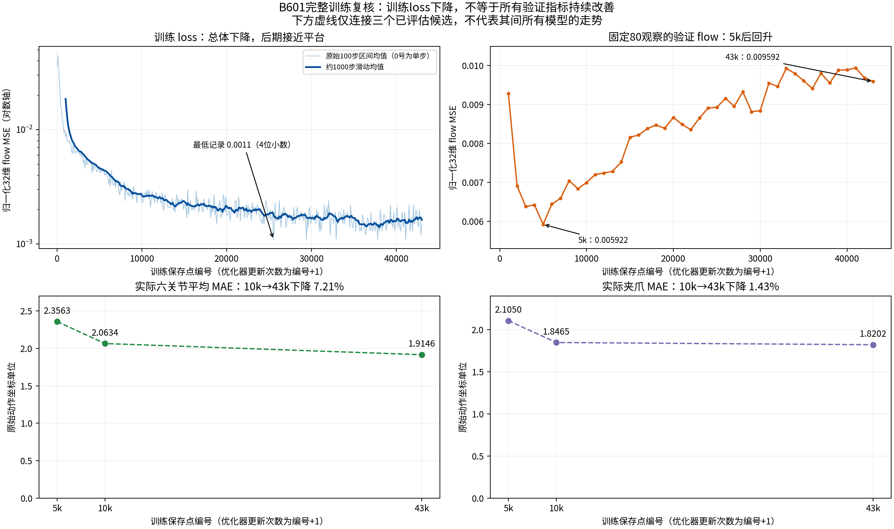

# 服务器B601完整实验记录

本目录提供2026-11-09至2026-11-10的实际服务器执行证据：环境与数据准备、两组20步短跑、12.273248小时正式训练、43,001次优化器迭代、完整离线评估、恢复/部署检查、异常与修复，以及后验loss复核。

## 阅读顺序

1. [最终方法、硬件与结论](../docs/server_final60/FINAL_REPORT_CN.md)
2. [本次loss曲线复核](loss_audit/LOSS_AUDIT_CN.md)：训练loss总体下降；验证flow在5k后回升；实际动作指标比较和局限分开说明。
3. [全部阶段时间线](TIMELINE_CN.md) / [可下载CSV](TIMELINE.csv)：包含实际命令、开始/结束时间、退出码，成功和失败尝试都保留。
4. [原始正式训练日志](raw_logs/formal-longrun-v1.log) / [去终端控制符的阅读版](FORMAL_LOG_READABLE.txt)
5. [完整训练曲线CSV](loss_audit/training_curve.csv)、[43次验证flow](loss_audit/validation_flow_curve.csv)、[逐episode动作比较](loss_audit/per_episode_comparison.csv)
6. [GPU资源采样说明](resources/RESOURCE_SUMMARY_CN.md) / [全部168,944行GPU原始CSV](resources/GPU_SAMPLES.csv)
7. [失败原因和修复记录](configuration/ISSUE_RESOLUTION_LOG.json)、[最终独立审计](audit_receipts/INDEPENDENT_FINAL_AUDIT.json)
8. [下载与部署指南](../docs/server_final60/DOWNLOAD_AND_START_CN.md)



## 实验参数与数据

- Linux Lenovo ThinkSystem ST650 V3，双Xeon Gold6530，Linux可见内存约503GiB，4张RTX A4500 20GB；正式π₀.₅使用物理GPU2/3、FSDP2、global batch4、workers2、seed42。
- OpenPI固定commit215abfb217dbac7d5f1273282331b9b1866c0479，JAX/JAXlib0.5.3。LoRA语言/动作分支，原生freeze filter同时训练视觉参数；完整环境见[ENVIRONMENT](configuration/ENVIRONMENT.json)，精确实际参数见[RUN_PARAMETERS](monitor/RUN_PARAMETERS.json)。
- final60固定50训练/10验证，28,729/5,118帧，名义25fps、两路RGB、7轴原始反馈/absolute_adapter_input动作、horizon25。训练统计用于归一化，验证复用同一统计。
- 原始数据见[私有final-60 Release](https://github.com/ken-ab/rebot-b601-training/releases/tag/final-60)，分割/校验/转换信息见[data_and_base](data_and_base/)。官方base下载的20个对象及校验见[base_verified_download](data_and_base/base_verified_download.json)。
- 20步smoke分别batch2和4，原始20条loss/梯度与checkpoint读回见[batch2](raw_logs/smoke-b2-v1.log)、[batch4](raw_logs/smoke-b4-v1.log)及对应stage_receipts。
- 正式训练最大200k为保护上限；LR warmup500、peak2.5e-5、decay10k到2.5e-6，save1000，按12.25小时后的完整保存点结束。实际活动时间44183.694040秒，末编号43000、优化器计数43001。
- [SESSION_START](monitor/SESSION_START.json)、[LONGRUN_COMPLETE](monitor/LONGRUN_COMPLETE.json)与[最后checkpoint参数/优化器读回](diagnostics/final_optimizer.json)相互绑定。计时排除准备和初始编译，包含正常验证与保存。

## 原始日志索引

| 阶段 | 主要实际记录 |
| --- | --- |
| 环境/转换 | [prepare-v1失败](raw_logs/prepare-v1.log)、[prepare-v2通过](raw_logs/prepare-v2.log)、[60条episode数据审计](raw_logs/full-data-audit-v1.log) |
| 基座下载与GPU | [首次校验处理失败](raw_logs/base-download-v1.log)、[修复后下载校验](raw_logs/base-download-v2.log)、[双GPU集合通信](raw_logs/jax-gpu-collective-v1.log) |
| 真实20步短跑 | [batch2](raw_logs/smoke-b2-v1.log)、[batch4](raw_logs/smoke-b4-v1.log)、[batch4完整参数读回](stage_receipts/smoke-b4-v1-orbax-readback.json) |
| 保存与恢复探针 | [首次探针](raw_logs/hook-probe-v1.log)、[从checkpoint10恢复并保存20](raw_logs/hook-resume-v1.log) |
| 正式长跑 | [完整原始stdout/stderr](raw_logs/formal-longrun-v1.log)、[431条训练记录](resources/CONSOLE_TRAIN_METRICS.jsonl)、[43个验证保存点](monitor/VALIDATION_METRICS.jsonl) |
| 真实动作评估 | [纯基座](raw_logs/full-eval-base-v1.log)、[flow最优5k](raw_logs/full-eval-best-v1.log)、[10k确定性复核](raw_logs/repro-candidate-checkpoint10000-v1.log)、[末端43k](raw_logs/full-eval-last-v1.log) |
| 数值一致性 | [严格自检原失败](raw_logs/deployment-rehearsal10000-v1.log)、[固定选核后通过](raw_logs/deployment-rehearsal10000-v2.log)、[问题与协议](diagnostics/DETERMINISM_V2_ACCEPTANCE.json) |
| 网络与客户端 | [紧凑RPC原失败](raw_logs/websocket-compact-rehearsal-v1.log)、[显式直连后通过](raw_logs/websocket-compact-rehearsal-v2.log)、[最终RPC](raw_logs/websocket-final-v1.log)、[211观察像素/线格式等价](diagnostics/CLIENT_PREPROCESS_EQUIVALENCE.json) |
| 8GB路线与部署检查 | [小BFC池OOM](raw_logs/inference-pool-7424-v1.log)、[最终platform分配器](raw_logs/final-low-memory-profile-v1.log)、[动作检查器36案例](raw_logs/action-guard-acceptance-v2.log) |
| 最终交付 | [模型包导出](raw_logs/deployment-export-v1.log)、[严格模型读回](raw_logs/deployment-inference-readback-v1.log)、[优化器读回](raw_logs/final-optimizer-readback-v1.log)、[独立归档审计](raw_logs/independent-final-delivery-audit-v1.log) |
| 独立ACT对照 | [ACT训练日志](raw_logs/act-formal-training-v1.log)、[ACT配置与结果](auxiliary_act/)；它不是π₀.₅转换版，未替换主模型 |
| 私有发布 | [HF上传日志](raw_logs/hf-publication-v1.log)、[全部138文件核验回执](publication_evidence/HF_PUBLICATION_RECEIPT.json)、[固定下载版本写入GitHub](raw_logs/github-model-link-v1.log) |

## 指标、版本与覆盖边界

训练loss是100步区间均值、四位小数；step0例外为单步。本次W&B禁用重绑定曾让计划中的单步hook失效，外部监测器从原始stdout恢复了431条记录。未保存的43,001条逐步全精度loss不能事后补造。

`observed_at`表示采集器读到日志的时间，启动时可能一次收集多条旧记录；不是每一步的精确GPU结束时间。训练计时以SESSION_START和checkpoint绑定时间为准。实时状态观察可能重复同一step，不能当作额外训练数据点。

`validation_flow_loss`对固定80观察的归一化32维向量场求MSE，含25补齐维与12%重复尾步；它不等于真实7轴动作误差。完整动作评估使用固定seed、每个观察单次采样、10步去噪积分，在211窗口中计5,118有效动作行、排除157尾padding行，分别报告六关节平均MAE和夹爪MAE。详细源代码和复算CSV在loss_audit。

`BEST.json`保存的是5k的flow代理最优点。最终选模在预定最多4个distinct候选中比较真实关节/夹爪MAE，实际有5k、10k、43k三个不同候选，选中43k。`best/candidate_flow_best`、`last/candidate_last`是同一候选的不同来源标签，不是额外独立模型。

[evaluation](evaluation/)是统一固定推理flags下的正式结果；[early_evaluation](early_evaluation/)是最初自动选核配置下的诊断/被替代结果，保留追踪，不与正式结果混成同一协议。跨进程原golden差异保留，固定推理XLA flags后重做候选；训练本身没有因此重启。strict容限未放宽。

[source_snapshots/executed_history](source_snapshots/executed_history/)含正式训练开始时实际源码与后续补救前版本；[current_b601](source_snapshots/current_b601/)是修复后的当前文件。当前文件不能冒充全部12小时执行版本，TRAINING_SOURCE_LOCK与历史目录用于确定执行来源。优化器/参数/计数恢复已实际测试；上游DataLoader位置不恢复，不承诺逐步完全一致续训。

完整权重和原始视频分别位于[HF固定私有模型版本](https://huggingface.co/dahjgfa/b601-pi05-final60/tree/8c11eb8751d5cc6f688fa51db523da5bd8f2518a)与原私有Release。本目录集中保存日志、参数配置、数据/权重校验、预测、监控和源码；凭据文件、令牌缓存和私人会话记录不属于实验归档。

## 如何核验

[MANIFEST.json](MANIFEST.json)记录每个归档文件的源路径、源SHA256及发布SHA256；发生凭据脱敏时明确标记，原服务器文件保持原样。[SCAN_REPORT.json](SCAN_REPORT.json)只记录命中文件/模式/数量，不记录秘密值。Git属性保证原始日志、CSV和源码快照不会被换行转换；原始文本格式不做代码风格修改。SHA256SUMS包含MANIFEST、不含自身。

```bash
sha256sum -c SHA256SUMS
```

GitHub对较大日志/CSV的在线预览可能不完整，下载原文件可获得全部内容。复核脚本为[source_snapshots/server_tools/audit_loss_curves.py](source_snapshots/server_tools/audit_loss_curves.py)，包含服务器路径，异机重放需适配数据位置。图表、CSV及JSON均由实际日志/已保存预测生成；本轮复核没有重新训练或替换已发布模型。

本次证据支持离线示教动作适配有效；验证集参与选模，只有10条验证episode，没有多种子和独立测试集；Windows4070/WSL、相机/USB/原适配器及机械臂闭环仍需现场联调，软件检查不能物理停止已发出的动作。
