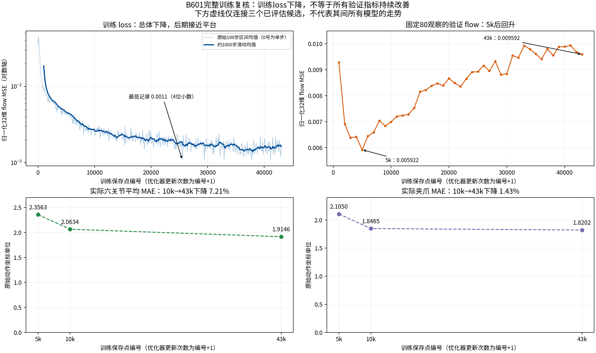

# Loss与训练流程复核（2026-11-10）

结论：训练loss总体下降，后期波动并趋于平台；固定验证flow在5k后回升。后续长跑对已比较的真实动作指标有收益，但不能说所有指标全程单调改善，更不能据此无限增加步数。

## 真实曲线与日志口径

正式训练有431条记录：step0为单步，此后每100步输出区间均值，保留四位小数。已从原始formal-longrun-v1.log重新解析，loss/grad_norm/param_norm与采集JSONL逐条完全一致。不能从这些区间均值恢复43,001条单步全精度loss。

早期400、600、700步分别为0.0168、0.0125、0.0115，800步已到0.0094。最低**记录区间均值**为0.0011，出现在25,500、29,400、32,900、37,800、41,100；末条为0.0015。这不等于已知最低单步loss。430次相邻记录比较有179次上升、206次下降、45次在四位小数下相等。

训练按step重抽flow噪声/插值时刻、采样数据并做图像增强，batch只有4，逐条不单调正常。Dropout默认0，不把本例波动泛称为dropout造成。固定验证使用同80个观察、相同种子及批次键、关闭训练增强；5k后持续回升不能归因为每次重抽了另一批验证噪声。

## 对比真实动作误差

| 保存点 | 训练100步均值 | 验证flow | 六关节平均MAE | 夹爪MAE |
| ---: | ---: | ---: | ---: | ---: |
| 5,000 | 0.0043 | 0.005922 | 2.356301 | 2.105016 |
| 10,000 | 0.0023 | 0.006995 | 2.063429 | 1.846545 |
| 43,000 | 0.0015 | 0.009592 | 1.914644 | 1.820183 |

10k→43k额外运行9.41活动小时，关节MAE下降7.21%，10条验证episode均改善；夹爪MAE仅下降1.43%，5条改善、5条变差。关节收益较一致，夹爪收益小且不一致。5k→43k关节/夹爪分别改善18.74%/13.53%，虽然验证flow反而上升61.99%。

所有动作指标已用保存的预测和目标在float64下复算；三个模型目标、mask、源episode/frame逐元素相同，211个窗口覆盖5,118有效动作行，每行计一次，157个尾部padding行被排除。两种动作单位分开报告，不把六关节和夹爪混成一个分数。这里只比较5k/10k/43k三个不同候选，未证明每个中间checkpoint都越来越好，或43k在全程全局最优。

## 发现的验证代理局限

1. 上游flow loss对quantile归一化后的32维向量场误差取MSE；机械臂实际7维，另外25维补零也参与loss。维度权重并不等于其实际误差贡献，现有聚合日志不能拆出各部分贡献。
2. 固定80观察每episode取8点，其中每个episode的末帧窗口有24个重复尾步。共2,000行中240行（12%）是人工重复尾部，未从flow loss剔除。真实动作MAE已排除尾部padding，计算口径正确。
3. 验证flow每episode8观察等权；动作整体MAE按5,118有效帧加权，并另存episode宏平均。两者覆盖和权重不同。
4. flow loss衡量一个随机插值时刻的向量场预测，动作MAE衡量10步积分后、反归一化后的真实7维端点误差，两者没有单调等价关系。验证单个固定随机draw/80观察也不是完整期望风险。

因此当前flow可保留为沿用上游目标的训练监控，但不能独自决定部署模型。验证回升是该目标泛化不足的警讯，不能仅凭代理差异排除过拟合，也不能仅凭不单调认定训练代码错误。尚未做维度/尾部/时刻分解消融，不编造“是哪一项造成62%回升”的归因。

## 流程复核与建议

未发现本次动作映射、训练/验证划分、训练统计复用或MAE公式错误。训练和验证样本分开，归一化只来自训练集；恢复、参数/优化器有限值读回、确定性推理与模型包哈希验收见原始审计。原执行monitor保存在服务器source_versions/formal_v1_before_wandb_hook_fix，本归档的[执行版本](../source_snapshots/executed_history/formal_v1_before_wandb_hook_fix/longrun_monitor.py)供对照；W&B禁用重绑定导致单步hook失效，当前loss曲线由100步控制台记录恢复，此限制已保留，不能补造单步数据。

后续应同时记录真实7维/有效时间mask的辅助flow、补齐维度flow，并定期评估实际关节/夹爪MAE，以任务指标和现场成功率安排早停。30k后训练均值已约0.0016的平台，10k后的夹爪收益很小；不建议只凭训练loss继续堆步数。此次43k模型在已评估候选的两个平均动作指标上均优，交付选择有实际证据。

验证集参与选模，只有10条episode；没有多随机种子或独立测试集，未测真机抓放成功率。此复核仅使用既有日志和预测，不重训、不改写已发布权重。源文件SHA、完整曲线CSV、区间统计和逐episode比较均在本目录。
